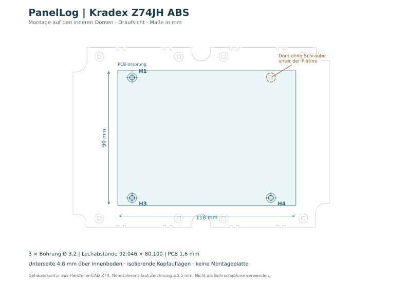

# Kradex-Gehäuse und Platinenbefestigung

PanelLog verwendet das **Kradex Z74JH ABS** mit Deckeldichtung. Die Platine liegt direkt auf den vier inneren Kunststoffdomen; drei Schrauben an H1, H3 und H4 befestigen sie. Der vierte Dom trägt die Platine ohne Schraube. Montageplatte und separate Abstandhalter sind nicht vorgesehen.

## Lochbild und Freiraum

Ursprung: linke obere PCB-Kante; X nach rechts, Y nach unten. PCB 118 × 90 × 1,6 mm; Bohrungen Ø 3,2 mm unplattiert.

| Befestigung / Auflage | X / Y ab PCB-Kante | KiCad X / Y |
|---|---|---|
| H1, Schraube | 9,452 / 4,875 mm | 90,452 / 49,375 mm |
| H3, Schraube | 9,452 / 84,975 mm | 90,452 / 129,475 mm |
| H4, Schraube | 101,498 / 84,975 mm | 182,498 / 129,475 mm |
| Vierter Dom, ohne Bohrung | 101,498 / 4,875 mm | 182,498 / 49,375 mm |

Die nominalen Domachsen und Lochachsen stimmen innerhalb 0,001 mm überein. Lochabstand horizontal 92,046 mm, vertikal 80,100 mm. Das ist eine CAD-Zuordnung; die Herstellerzeichnung nennt ±0,5 mm allgemeine Toleranz. Bei einem 2,9-mm-Schraubenschaft bleiben in einer 3,2-mm-Bohrung nur 0,15 mm radiales Spiel; die allgemeine ±0,5-mm-Gehäusetoleranz ist dadurch nicht vollständig abgedeckt. Eine Passprobe am Originalgehäuse ist erforderlich. Bohrungen beim Einbau spannungsfrei ausrichten und die Platine nicht mit Schrauben in Position zwingen.

Die Auflagen haben Ø 6,05 mm. Bei direkter Auflage liegen PCB-Unterseite und Domoberkante bei Z = −1,6 mm, der Innenboden bei Z = −6,4 mm: **4,8 mm nominale Bodenfreiheit**. Das PCB-Volumen durchdringt die Gehäusewand nicht. Der kleinste nominale Wandabstand auf PCB-Höhe beträgt etwa 5,83 mm; der Abstand der nackten Platine zum Deckel etwa 29,09 mm. Bauteile, Schrauben, Lötstellen und Kabel benötigen eigenen Freiraum.

## Schrauben und Montage

Die Dome haben annähernd quadratische Kernöffnungen mit 2,35 mm Nennweite. Ein passender Ausgangspunkt ist eine gewindeformende Kunststoffschraube mit etwa 2,9 mm Durchmesser und 6 mm Länge unter Kopf. Mit 1,6-mm-PCB und etwa 0,5-mm-Isolierscheibe ergeben sich rund 3,9 mm Einschraubtiefe. Gewindeform, Kopf und Anzugsmoment am Originalgehäuse abstimmen; dies ist keine vom Hersteller spezifizierte Schraubenfreigabe. Die mit dem Gehäuse gelieferten langen Deckelschrauben gehören nicht in die PCB-Dome.

**Isolierende Kopfauflagen verwenden.** Der 7-mm-Kreis im Befestigungs-Footprint ist nur ein Montagefreiraum (Courtyard), keine Kupfersperrfläche. Metallische Schraubenköpfe dürfen weder Kupfer noch Vias berühren; eine Lötstoppmaske allein ist keine mechanisch belastbare Isolation. Schrauben nur so weit anziehen, dass die Platine aufliegt. Schraubenspitzen dürfen den Gehäuseboden nicht erreichen oder durchstoßen.

Der unverschraubte vierte Dom bleibt unter der Platine. Dort keine unterseitigen Bauteile, Drahtenden oder Abstandhalter einsetzen. Leistungsleitungen und Sensorleitungen separat zugentlasten; die drei PCB-Schrauben dürfen keine Kabelzugkräfte aufnehmen.

## Zeichnung und 3D-Einbindung

| Datei | Inhalt |
|---|---|
| [Z74.pdf](../hardware/mechanical/Z74.pdf) | Unveränderte Herstellerzeichnung: Zusammenbau, Unterteil und Deckel |
| [Z74_2000.dwg](../hardware/mechanical/Z74_2000.dwg) | Originale Hersteller-CAD-Datei mit Zeichnungen und Körperdaten |
| [Z74_base_reference.dxf](../hardware/mechanical/Z74_base_reference.dxf) | Abgeleitete Draufsicht mit Boden und Auflagen |
| [Unterteil STEP](../hardware/3dmodels/manufacturer/Kradex_Z74_base.step) | Gehäuseunterteil |
| [Deckel STEP](../hardware/3dmodels/manufacturer/Kradex_Z74_cover.step) | Gehäusedeckel |
| [Montageübersicht SVG](../hardware/mechanical/PanelLog_Z74_montage.svg) | Aktuelle PCB-Lage und drei Befestigungen |

Unterteil und Deckel sind am PCB-Footprint H1 mit relativen `${KIPRJMOD}`-Pfaden eingebunden: Offset **X = 45,848 / Y = −40,125 / Z = 46,05 mm**, Maßstab 1, Drehung 0°. Der Deckel hat 25 % Deckkraft. In KiCad lassen sich beide Modelle unter H1 einzeln ausblenden.

Im kartesischen 3D-System (PCB-Oberseite Z = 0; Y entgegen der KiCad-Bildschirmrichtung) werden beide STEP-Dateien um **(136,3 / −89,5 / 46,05) mm** verschoben. Die vorhandenen SAT-Körper liegen unter [hardware/mechanical](../hardware/mechanical/). Die STEP-Dateien stammen aus diesen Herstellerkörpern; vier schmale Übergangsflächen am Unterteil sind bei der Konvertierung angenähert. Die Deckel-/Dichtungsfuge und Fertigungstoleranzen sind deshalb am realen Gehäuse zu beurteilen. Die Variantenmodelle von Shunt und Spule bilden keine exakten Herstellerteile ab.

Quelle: [Kradex Z74, Herstellerdownloads](https://www.kradex.com.pl/product/obudowy_hermetyczne/z74jh_abs?lang=pl). Herstellerzeichnung und CAD bleiben unverändert; Copyright-Hinweise von Kradex gelten weiter. Kabelverschraubungen und deren Bohrungen werden erst mit den gewählten Leitungen und Gegenmuttern festgelegt.
